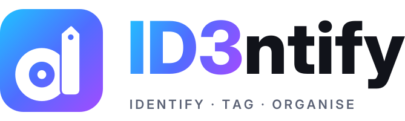

<p align="center">
  <picture>
    <source media="(prefers-color-scheme: dark)" srcset="assets/id3ntify-logo-dark.svg">
    
  </picture>
</p>

<p align="center"><b>Identify, tag and organise your music.</b><br>
A free, open-source Windows app that works out what a song is, fixes its tags and cover art, and files it where it belongs.</p>

<p align="center">
  <a href="https://github.com/id3ntify/id3ntify.app/releases/latest"><b>Download for Windows</b></a> ·
  <a href="https://id3ntify.app">Website</a> ·
  <a href="https://ko-fi.com/id3ntify">Buy me a coffee</a>
</p>

---

## What it does

- **Identify any song.** Open a file, drag one in, or let it listen through your microphone or to whatever your PC is playing.
- **Two opinions, not one.** Every song is checked by more than one recognition service (AcoustID / MusicBrainz and Instant ID, plus ACRCloud or AudD if you have keys). Tags are only written when they agree, so you don't get confident wrong answers.
- **Tries harder on the hard ones.** If a song isn't recognised straight away, Instant ID listens again at other points in the song, and the **Preview check** looks up the song your filename or tags name on Deezer and iTunes and compares the store preview with your audio. The filename never counts as a match by itself. The sound has to match.
- **Whole folders at once.** Bulk identification works through a folder, and its subfolders if you like. Each song gets a clear status: Confirmed, Needs checking or Tagged.
- **Proper tags.** Title, artist, album artist, album, year, genre, track and disc numbers, and embedded cover art.
- **Rename and organise** with your own pattern, such as `%ARTIST%\%ALBUM%\%TRACK% - %TITLE%`.
- **Undo anything.** Every change is saved in History with before and after. Revert one song or a whole batch.
- **Duplicate finder.** Finds copies of the same song across folders, scores how sure it is (optionally by comparing the audio itself), and suggests which copy to keep.
- **Plex friendly.** It can ask your Plex server to rescan after tagging.
- **Private.** No accounts, ads or tracking. See [Privacy](docs/PRIVACY.md).

## Install

1. Download **`ID3ntify-Setup-<version>.exe`** from [Releases](https://github.com/id3ntify/id3ntify.app/releases/latest).
2. Run it. Choose **Install for me only** if you don't have admin rights.
3. Start ID3ntify from the Start menu. A short welcome guide sets everything up.

Windows may show a SmartScreen warning because the installer isn't code-signed yet. Click **More info → Run anyway**.

Updates install over the top. Your settings, history and backups (in `%APPDATA%\ID3ntify`) are kept.

## Feedback and support

- **Found a bug or have an idea?** [Open an issue](https://github.com/id3ntify/id3ntify.app/issues), or use **Help & feedback** in the app. **Copy diagnostics** there adds useful details without any personal information.
- **Email:** hello@id3ntify.app
- **Like it?** [Buy me a coffee](https://ko-fi.com/id3ntify) ☕

## Build from source

You need Windows 10 or 11 and Python 3.12 (`winget install Python.Python.3.12`).

1. Download or clone this repository.
2. Double-click **`build.bat`**. No admin is needed. It downloads everything it needs (Python packages, FFmpeg, fpcalc, Inno Setup), builds the app and makes the installer.
3. The installer is saved as `dist\ID3ntify-Setup-<version>.exe`. To try the app without installing, run `dist\ID3ntify\ID3ntify.exe`.

To run straight from the source code instead, install the packages (`pip install shazamio soundcard "numpy<2" pywebview`), make sure `ffmpeg`, `ffprobe` and `fpcalc` are on your PATH, then run `run-from-source.bat`.

### Command line

The engine also works on its own, without the window:

```powershell
python engine.py scan  "D:\Music\To sort"
python engine.py apply "D:\Music\To sort" --organize "D:\Music\Library"
```

### Project layout

| File | Purpose |
|---|---|
| `app.py` | Local server (127.0.0.1 only, random port, secret token) and the app window |
| `ui.html` | The whole interface |
| `engine.py` | Identification engine: services, voting, tag writing, rename and organise |
| `dupes.py` | Duplicate finder |
| `capture.py` | Microphone and desktop-audio recording |
| `brand.py` | Name, version, links and built-in keys |
| `docs/` | Privacy policy, licence and terms, and third-party licences (shown in the app) |
| `installer/` | Inno Setup script and exe version info (filled in from `brand.py` by the build) |
| `assets/` | Icon and logo |

## Licence

ID3ntify is created by **Elias Hajjar**. Copyright © 2026 Elias Hajjar.

The code is free software under the [GNU General Public License v3.0 or later](LICENSE). You can use, study, change and share it. If you share a changed version, you must share its source code under the same licence and keep the copyright notices.

The **ID3ntify name, logo and icon are not covered by the GPL** and are reserved. The artwork in `assets/` is © 2026 Elias Hajjar, all rights reserved. If you publish a fork, please give it your own name and icon. See [TRADEMARKS.md](TRADEMARKS.md).

ID3ntify uses third-party components and services under their own licences and terms. See [Third-party licences](docs/THIRD_PARTY_NOTICES.md). It isn't affiliated with or endorsed by any of the services it uses.
